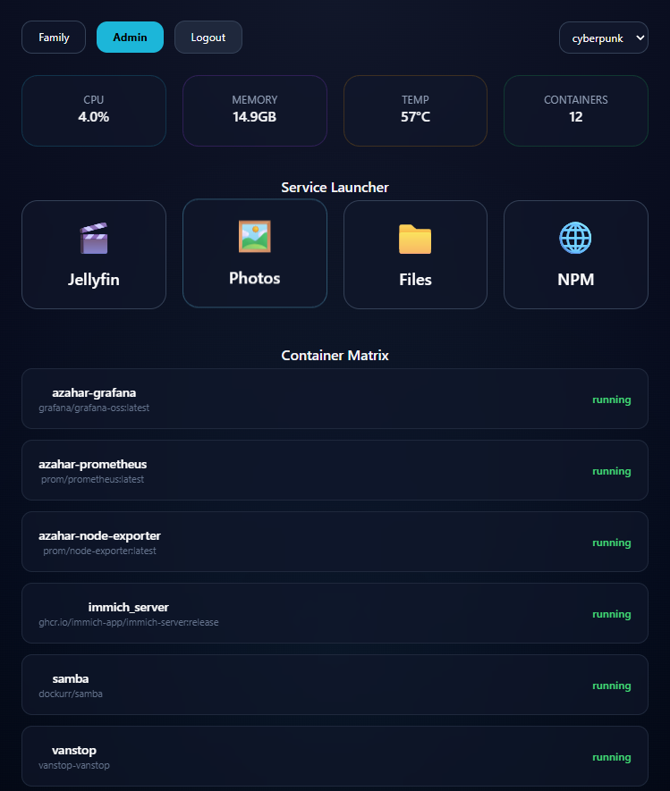
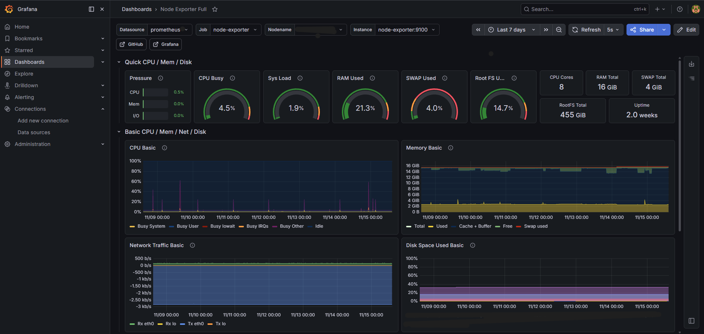
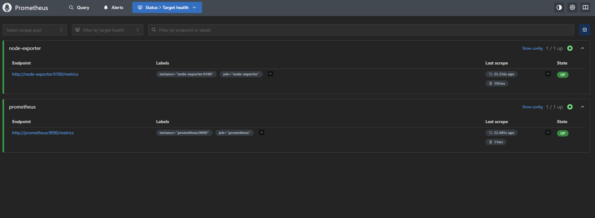

# Azahar HomeBase

**A self-hosted home infrastructure and monitoring platform built with Ubuntu, Docker, React, Node.js, Prometheus and Grafana.**

Azahar HomeBase is a personal engineering project focused on providing private family services, managing a home server environment and monitoring infrastructure performance.

The project combines a React-based web application with a Node.js backend, SQLite database and an independently deployed infrastructure monitoring stack.

It is also a practical learning environment for Linux administration, application development, containerisation, infrastructure monitoring and Cloud Engineering.

## Project Overview

Azahar HomeBase has two main components:

- **HomeBase Application:** A web interface for accessing family services and managing requests.
- **Infrastructure Monitoring:** A Prometheus, Node Exporter and Grafana stack for monitoring the Ubuntu host.

### Key objectives

- Build and maintain private, self-hosted family infrastructure.
- Develop a web application using React and Node.js.
- Implement application authentication and session management.
- Manage infrastructure services using Docker and Docker Compose.
- Monitor Linux host performance using Prometheus and Grafana.
- Practise troubleshooting, configuration management and technical documentation.
- Develop practical skills relevant to Cloud Engineering and DevOps.

## Screenshots

### HomeBase Administration


### Grafana Infrastructure Monitoring


### Prometheus Targets


## Architecture

### HomeBase application architecture


### Homelab and AWS contingency architecture


> **Architecture status:** The AWS diagram represents a proposed contingency and recovery architecture. Automated failover and disaster recovery are not currently implemented.

### Application components

| Component | Technology | Purpose |
|---|---|---|
| Frontend | React, Vite | User interface and administration views |
| Backend | Node.js, Express | API and application logic |
| Database | SQLite | Application data and requests |
| Authentication | Node.js Crypto | Password verification and signed sessions |
| Host information | systeminformation | System resource information |
| Docker integration | Dockerode | Container information |

### Monitoring components

| Component | Technology | Purpose |
|---|---|---|
| Metrics collection | Prometheus 3.16.0 | Metrics collection and storage |
| Host metrics | Node Exporter 1.12.1 | Linux system metrics |
| Visualisation | Grafana OSS 13.0.2 | Infrastructure dashboards |
| Deployment | Docker Compose | Monitoring container management |

Prometheus collects metrics from Node Exporter at 60-second intervals. Grafana uses Prometheus as its data source to visualise infrastructure performance.

## Monitoring Capabilities

The current monitoring dashboard provides visibility into:

- CPU utilisation and system load.
- Memory and swap usage.
- Filesystem capacity.
- Disk read and write activity.
- Network traffic.
- System uptime.

Prometheus and Grafana use persistent Docker volumes to retain monitoring data.

The monitoring stack operates independently of the HomeBase application.

## Technology Stack

| Area | Technologies |
|---|---|
| Operating system | Ubuntu Server |
| Containers | Docker |
| Container management | Docker Compose |
| Frontend | React, Vite, JavaScript |
| Backend | Node.js, Express |
| Database | SQLite |
| Monitoring | Prometheus, Node Exporter, Grafana OSS |
| Version control | Git, GitHub |
| Development tools | npm, Bash, PowerShell |

## Repository Structure

```text
azahar-homebase-portfolio/
├── backend/
│   ├── .env.example
│   ├── db.js
│   ├── index.js
│   ├── package.json
│   └── package-lock.json
├── frontend/
│   ├── public/
│   ├── src/
│   │   ├── components/
│   │   ├── config/
│   │   ├── pages/
│   │   └── themes/
│   ├── package.json
│   ├── package-lock.json
│   └── vite.config.js
├── monitoring/
│   ├── docker-compose.yml
│   └── prometheus/
│       └── prometheus.yml
├── docs/
│   ├── architecture.md
│   ├── monitoring.md
│   ├── diagrams/
│   │   ├── application-architecture.png
│   │   └── homelab-aws-failover-architecture.png
│   └── screenshots/
│       ├── homebase-dashboard.png
│       ├── homebase-admin.png
│       ├── grafana-monitoring.png
│       └── prometheus-targets.png
├── .gitignore
└── README.md
```

## Deployment and Development

### 1. Clone the repository

```bash
git clone https://github.com/ashiqazlan/azahar-homebase-portfolio.git

cd azahar-homebase-portfolio
```

The repository is private, so GitHub access is required.

### 2. Configure the backend

```bash
cd backend

npm ci

cp .env.example .env
```

Configure the environment variables in `.env`:

| Variable | Purpose |
|---|---|
| `PORT` | Backend API port |
| `NODE_ENV` | Application environment |
| `ADMIN_PASSWORD_HASH` | Administrator password hash |
| `SESSION_SECRET` | Session signing secret |
| `JELLYFIN_URL` | Jellyfin service address |
| `PHOTOS_URL` | Photos service address |
| `FILES_URL` | File service address |
| `NPM_URL` | Nginx Proxy Manager address |

Set the required secrets and service addresses locally. Do not commit the `.env` file.

Start the backend:

```bash
npm start
```

The backend listens on port `3001` by default.

### 3. Start the frontend

Open another terminal:

```bash
cd frontend

npm ci

npm run dev
```

The Vite development server normally starts on port `5173`, selecting another available port if necessary.

The frontend development configuration proxies API requests to the local backend.

### 4. Build and validate the frontend

```bash
npm run lint

npm run build
```

### 5. Deploy the monitoring stack

From the repository root:

```bash
docker compose -f monitoring/docker-compose.yml up -d
```

Check container status:

```bash
docker compose -f monitoring/docker-compose.yml ps
```

View Prometheus logs:

```bash
docker compose -f monitoring/docker-compose.yml logs prometheus
```

The Grafana interface is published on port `3002` by the current Compose configuration.

Prometheus and Node Exporter are exposed to their Docker network but are not published as host ports.

For further monitoring configuration, see [Monitoring Documentation](docs/monitoring.md).

## Configuration and Security

The project includes several security measures:

- Application secrets are configured through environment variables.
- Environment files are excluded from version control.
- Password verification uses Node.js scrypt.
- Authentication sessions use HMAC-SHA256 signatures.
- Session cookies use HttpOnly and SameSite protections.
- Session expiry is enforced by the backend.
- Monitoring data is stored in persistent Docker volumes.
- Prometheus and Node Exporter are not published to host ports by the current Compose configuration.

**Current security considerations:**

Some family-accessible API routes rely on the trusted home network and VPN access boundary rather than administrator authentication. This is a known limitation and an area for further hardening.

The Docker socket and administrative interfaces also require appropriate access controls.

This project is designed for a controlled homelab environment and should not be considered a production-hardened public service.

Never commit passwords, session secrets, private keys, database files or personal infrastructure details.

## Project Status

### Implemented

- React frontend and Node.js backend.
- SQLite application database.
- Backend authentication and session handling.
- Family service and request management interfaces.
- Docker-based monitoring stack.
- Prometheus metrics collection.
- Node Exporter host metrics.
- Grafana infrastructure dashboard.
- Architecture and monitoring documentation.

### Planned improvements

- Complete monitoring access hardening.
- Additional backup and disaster recovery procedures.
- Further infrastructure automation.
- AWS-based contingency infrastructure exploration.
- Improved application interface and user experience.

## Documentation

- [Architecture Documentation](docs/architecture.md)
- [Monitoring Documentation](docs/monitoring.md)

## Project Purpose

Azahar HomeBase is an ongoing practical engineering and learning project.

It demonstrates hands-on work with Linux administration, application development, containerisation, infrastructure monitoring, troubleshooting and version control.

The objective is to build, understand and document infrastructure that can be demonstrated and technically explained as part of a Cloud Engineering and DevOps portfolio.
