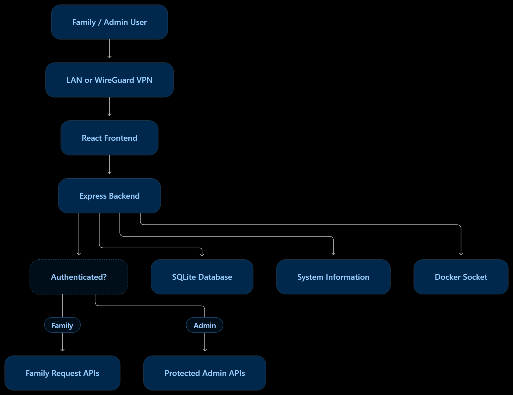
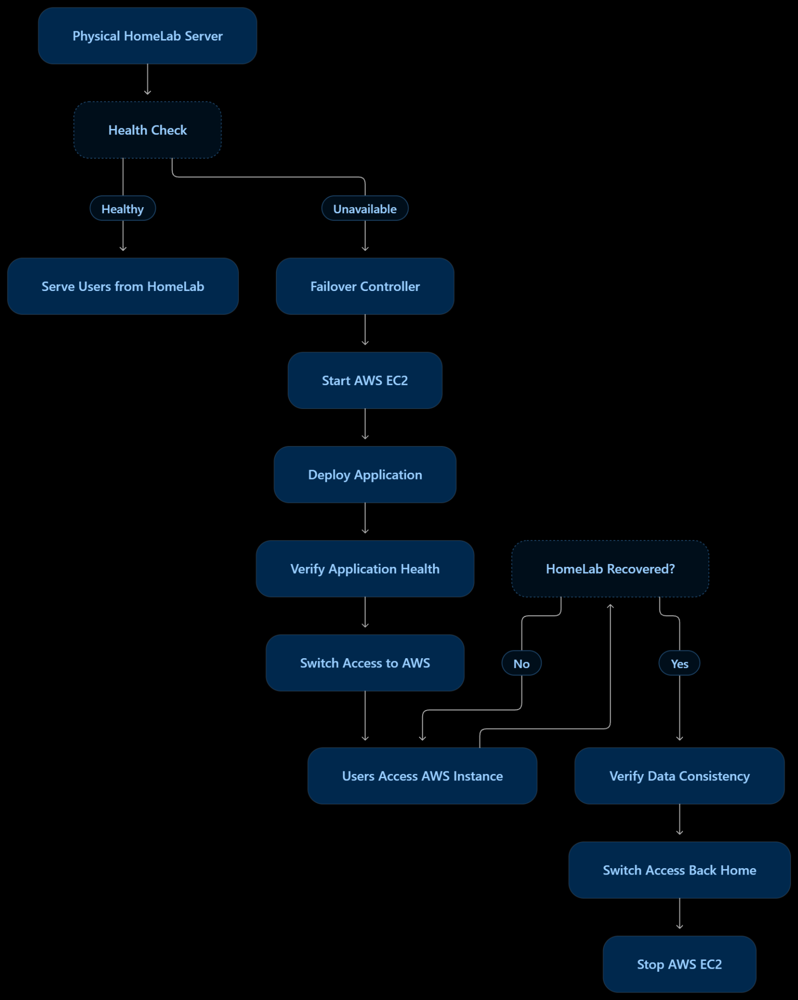

# Azahar HomeBase

**A self-hosted homelab and infrastructure monitoring project built around Ubuntu, Docker, React, Node.js, Prometheus and Grafana.**

Azahar HomeBase is a personal infrastructure project focused on private family services, application development, infrastructure monitoring and practical Linux administration.

The project combines a web-based HomeBase application with a separately managed monitoring stack running on an Ubuntu server.

## Project Objectives

- Build and maintain a self-hosted home infrastructure.
- Develop a web application for managing family services.
- Implement backend authentication and session management.
- Manage application components and services using Docker.
- Monitor Linux infrastructure using Prometheus and Grafana.
- Practise infrastructure management, troubleshooting and documentation.
- Develop practical skills relevant to Cloud Engineering and DevOps.

## Architecture Diagrams

### HomeBase Application Architecture



### Homelab and AWS Contingency Architecture



> Note: The AWS failover diagram represents the proposed recovery architecture. Automated failover and recovery are not yet implemented.

## Architecture Overview

The project has two main areas:

### 1. HomeBase Application

| Component | Technology | Purpose |
|---|---|---|
| Frontend | React, Vite | User interface and admin dashboard |
| Backend | Node.js, Express | API and application logic |
| Database | SQLite | Application data |
| Authentication | Node.js Crypto | Password hashing and signed sessions |
| System information | systeminformation | Host resource information |
| Docker integration | Dockerode | Docker service information |

### 2. Infrastructure Monitoring

The monitoring stack runs independently using Docker Compose.

| Component | Technology | Purpose |
|---|---|---|
| Monitoring | Prometheus | Metrics collection and storage |
| Metrics exporter | Node Exporter | Linux host metrics |
| Visualisation | Grafana OSS | Infrastructure dashboards |
| Deployment | Docker Compose | Container management |

Prometheus collects metrics from Node Exporter at 60-second intervals. Grafana uses Prometheus as its data source to display infrastructure performance.

## Monitoring Capabilities

The current Grafana dashboard provides visibility into:

- CPU utilisation and system load
- Memory and swap usage
- Filesystem capacity
- Disk read and write activity
- Network traffic
- System uptime

The monitoring stack uses persistent Docker volumes for Grafana and Prometheus data.

## Technology Stack

- **Operating System:** Ubuntu Server
- **Containers:** Docker
- **Container orchestration:** Docker Compose
- **Frontend:** React, Vite, JavaScript
- **Backend:** Node.js, Express
- **Database:** SQLite
- **Monitoring:** Prometheus, Node Exporter, Grafana OSS
- **Version control:** Git and GitHub

## Repository Structure

```text
azahar-homebase/
├── backend/
│   ├── db.js
│   ├── index.js
│   └── package.json
├── frontend/
│   ├── public/
│   ├── src/
│   └── package.json
├── monitoring/
│   ├── docker-compose.yml
│   ├── prometheus/
│   │   └── prometheus.yml
│   └── grafana/
│       └── provisioning/
├── docs/
│   ├── architecture.md
│   └── monitoring.md
├── .gitignore
└── README.md
```

## Monitoring Deployment

The monitoring stack is managed independently from the application.

Start the monitoring services:

```bash
docker compose -f monitoring/docker-compose.yml up -d
```

Check container status:

```bash
docker compose -f monitoring/docker-compose.yml ps
```

View Prometheus logs:

```bash
docker compose -f monitoring/docker-compose.yml logs prometheus
```

## Configuration and Security

- Application secrets are stored in environment variables.
- Environment files are excluded from version control.
- Passwords are verified using Node.js scrypt.
- Authentication sessions use HMAC-SHA256 signatures.
- Session cookies use HttpOnly and SameSite protections.
- Monitoring data is stored in persistent Docker volumes.
- Prometheus and Node Exporter ports are not published to the host network by the current Compose configuration.

Never commit passwords, session secrets, private keys, database files or personal infrastructure details.

## Project Status

**Implemented:**
- React frontend and Node.js backend.
- SQLite application database.
- Backend authentication and session handling.
- Docker-based monitoring stack.
- Prometheus metrics collection.
- Node Exporter host metrics.
- Grafana infrastructure dashboard.

**Future improvements:**
- Complete monitoring access hardening.
- Infrastructure and deployment documentation.
- Backup and disaster recovery procedures.
- Further automation and infrastructure management.
- AWS-based contingency infrastructure exploration.

## Project Purpose

Azahar HomeBase is an ongoing practical learning and engineering project. It demonstrates hands-on experience with Linux administration, application development, containerisation, infrastructure monitoring and troubleshooting.

The objective is to build, understand and document infrastructure that can be demonstrated and explained technically.
